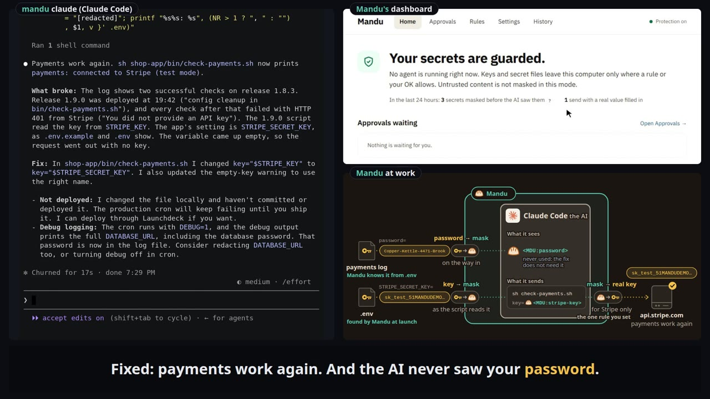

# Mandu

*Your agent sees the wrapper, never the filling.*

[](https://github.com/mandusec/mandu/actions/workflows/ci.yml)
[](https://www.npmjs.com/package/@mandusec/mandu)
[](LICENSE)
[](#supported-agents-and-platforms)
[](https://arxiv.org/abs/2607.03821)
[](https://arxiv.org/abs/2503.15547)

Mandu keeps your secrets for you, and keeps your AI agent useful. Run Claude
Code, Codex and other coding agents next to your real keys and secret files.
The AI sees your secrets masked. You, and the programs that need them, still
get the real values.

Works with Claude Code, Codex, OpenCode, OpenClaw and Goose, with no plugin
and no changes to the agent. Website: [mandusecurity.com](https://mandusecurity.com/).

[](https://mandusecurity.com/#demo)

▶ [Watch the demos](https://mandusecurity.com/#demo): debug, deploy and paperwork, on all five agents.

## Get started

Mandu uses your agent's own login, Claude Pro and Max included, and needs no
API key of its own. No account, no Mandu server and no telemetry: everything
Mandu stores stays in `~/.mandu`.

```sh
npx @mandusec/mandu scan         # first: which of your secrets your agents already sent to the AI
npm install -g @mandusec/mandu   # needs Node 22.13 or newer
mandu doctor                     # check this computer: Node, git, your agent, your secrets
mandu claude                     # your agent, protected (or: mandu codex)
mandu dashboard                  # what was protected, and what waits for your OK
```

No Node, or another way to install: [Getting started](docs/getting-started.md#1-install).
New to Mandu? `mandu demo` runs the real components offline against a
stand-in AI, and [Your first session](docs/first-session.md) is a
fifteen-minute tour with your own agent.

## The same file, read two ways

```
# ~/proj/.env, as the AI sees it
STRIPE_KEY=$MDU:nomodel_Read[9bbd].STRIPE_KEY
GH_TOKEN=$MDU:nomodel_Read[3e1a].GH_TOKEN
DEBUG=1

# the same file on your disk, for the programs and hosts you allow
STRIPE_KEY=sk_live_51Hq8xT2…
GH_TOKEN=ghp_7Qx2Lm9a…
DEBUG=1
```

The AI gets a stand-in it can pass around and put in a command. The file on
your disk keeps the real value, and Mandu hands it only to the programs and
hosts you allow, like `api.stripe.com`. Only secrets change.

## The problem

Coding agents read your files as they work: `.env`, SSH keys, cloud logins,
and your documents too. Once a key or a document is read, it rides along in
every request to the AI company. And whatever the agent holds can go to any
server a command names. The usual fixes each stop somewhere ([ten products
compared](https://mandusecurity.com/engineering/why-mandu/), [eight measured](#evidence)):

- **Fence the agent** (a sandbox, deny rules): what it reads still goes to
  the AI provider, and a denied `.env` is denied to your programs too.
- **Swap the credential** (a stand-in key): API keys over HTTP only; files
  and output the agent reads still reach the AI provider.
- **Filter the content**: blocked data can't be used; what programs send isn't checked.
- **Rebuild the agent or move the model**: the network side stays open.
- **Mandu** acts on the path to the AI, around the tools and on the network.

## How it works

Each secret has a rule, set on the dashboard's Rules page or in
`~/.mandu/policy.yaml`. A rule answers two questions.

**1. Which AI may read it?**

| | |
|---|---|
| **No AI** (`no-model`) | Every AI sees it masked, Mandu's own helper included. |
| **Your own AI only** (`local-model`) | Only an AI you run and list, such as Ollama, may read it, when it asks. |
| **Any AI, when it asks** (`any-model`) | The AI first sees it masked; the read is logged, and your AI provider gets the text. |
| **Not secret** (`public`) | An ordinary file, even if it looks like a secret. |

**2. Where may it be sent?**

| | |
|---|---|
| **Needs your OK** (the default) | Every send of the real value waits on the Approvals page: *Allow once*, *Always allow* or *Block*. One exception: a key whose format names the service that issued it (a Stripe `sk_live_…` key, a GitHub `ghp_…` token, a Notion `ntn_…` token, …) goes to that service's own API host without asking, in the sign-in header over HTTPS only (`issuer_bindings: false` turns it off). |
| **Listed hosts** (`bindings`) | The hosts you list get the real value without asking, so list only hosts you trust. |
| **Per value** (`values`) | In a file of several secrets, such as a `.env`, each value has its own hosts. |

```yaml
# ~/.mandu/policy.yaml
paths:
  - path: ~/proj/.env
    level: no-model                  # No AI
    bindings: [api.stripe.com]       # the real key goes only there
  - path: ~/.ssh/id_ed25519
    level: no-model
    readers: [{ app: ssh, from: git }]   # only an ssh that git started opens the real file
  - path: ~/work/board-memo-q4.md
    level: local-model               # Your own AI only
models:
  - { name: ollama, url: "http://127.0.0.1:11434", wire: openai-chat, model: llama3.2, local: true }
```

Your OK never lets an AI past the first question; only changing the rule
does. Mandu finds the usual credential files by itself, so a fresh install
already masks them. The full schema is in the
[user guide](docs/usage.md#secrets-in-policyyaml-who-may-read-what-and-what-leaves),
and the plain-language tour of the machinery in
[How Mandu works](docs/how-it-works.md).

Under the hood, Mandu sits where data enters or leaves the agent's world: a
model proxy masks secrets before they reach the AI, an egress proxy unmasks
them only on the way to a host the rule lists or you approve, a file guard
gives every program the rule does not name the masked copy, and a reply
filter shows you the real values in the agent's replies. It all runs as your user, with no root, and adds kernel
hardening (seccomp, Landlock, a no-network sandbox for read-only commands)
wherever your kernel allows. If Mandu cannot decide, it fails closed: the value
stays masked or the action is blocked.

### What it does not cover

- **Prompt injection.** With Protection on (the default, `secrets` mode),
  Mandu does not mask untrusted text: a web page or an issue comment reaches
  the AI as written, and can still steer the agent, for example into sending out source
  code that is not a registered secret.
- **The agent's own sign-in.** `ANTHROPIC_API_KEY`, `OPENAI_API_KEY` and the
  agent's other login variables are never masked ([list](docs/usage.md)).

What each setting guarantees, and how to check it on your machine:
[What Mandu guarantees](docs/guarantees.md).

## Evidence

We ran fifteen everyday tasks with a secret in them (file a bug report, go
through the inbox, scrub a key from git history, debug a payment error, move a
`.env` to the hosting platform, text the dog sitter the house codes, file a tax
extension, and more), three times each, live with Claude Code 2.1.295 and
Claude Sonnet 5.5: under Mandu, under eight other protections and under none
(19 October 2026, 450 runs). A run counts only when the secret was kept and the
task got done:

| Setting | Kept the secret and did the task |
|---|---|
| Mandu, with a rule for each task | 43 of 44 |
| Mandu, fresh install, no setup | 41 of 45 |
| Claude Code credential mask, set up for each task | 27 of 45 |
| PrivAiTe gateway | 25 of 44 |
| Claude Code deny rules, set up for each task | 14 of 45 |
| fencepost plugin | 10 of 44 |
| NVIDIA OpenShell, set up as its docs direct | 8 of 45 |
| nono sandbox | 4 of 45 |
| NVIDIA OpenShell, whole project inside | 3 of 45 |
| No protection | 2 of 44 |

A total of 44 means one run the model's own safeguards stopped, left out. Some
tools cannot do some tasks by design; counted only over the tasks both sides
can do, Mandu still leads each of them. With a browser agent (browser-use on
Gemini 2.5 Flash, six web chores, three runs each) no secret was kept without
Mandu (0 of 18) and every one was kept with it (18 of 18, 17 chores done).

Read these with their caveats: we chose the tasks, and some suit Mandu's
design (only Mandu can send a read to a model on your own machine); we improved
Mandu using earlier runs of these same tasks, and the other tools got no such
tuning; on a fresh install the person answers "always" the first time Mandu
asks about a key's own API host; one agent, one model, three runs per task. The
method, every task's result, the configurations and all the caveats are in
[`comparisons.md`](docs/design/confidentiality/comparisons.md) §5.

## Supported agents and platforms

| Agent | Tested versions | Status |
|---|---|---|
| Claude Code | 2.1.273 to 2.1.295 | supported |
| Codex | 0.136.0 to 0.162.0 | supported |
| OpenClaw | 2026.3.12 to 2026.9.9 | supported |
| OpenCode | 1.18.13 to 1.18.35 | preview |
| OpenCode 2 | 2.0.23 to 2.0.26 | preview |
| Goose | 1.53.0 to 1.54.0 | preview |

A **preview** agent runs with every protection but was tested less. Outside
these versions a launch warns in one line and the agent still starts; tools
Mandu does not know yet are treated as untrusted. Programs built on the
[Claude or Codex SDK](docs/usage.md#run-your-agent) work too.

**Platforms.** Linux x64 (Ubuntu 24.04 and 26.04 tested). ARM Linux and WSL2
are included but less tested; macOS is experimental. Codex on Ubuntu needs
`sudo apt install bubblewrap` once, then `mandu setup`; `mandu doctor` says
when a machine needs this. Per-agent notes (models, OpenCode plugins,
OpenClaw's Node version):
[Supported agents](docs/design/agents/supported-agents.md) and the
[user guide](docs/usage.md#troubleshooting).

## Documentation

All documentation starts at [`docs/`](docs/README.md). `mandu --help` lists
every command. To turn Mandu off, start the agent without the `mandu` prefix;
to remove it, see [Uninstall](docs/usage.md#uninstall).

## Research

Mandu builds on our experience with Prompt Flow Integrity
([arXiv:2503.15547](https://arxiv.org/abs/2503.15547)) and DualView
([arXiv:2607.03821](https://arxiv.org/abs/2607.03821)). It works at the
operating-system level instead of inside one agent framework, and protects
secrets with placeholders; from [DualView](https://github.com/compsec-snu/dualview)
it carries forward the placeholder table and the policy engine. If you use
Mandu in research, please cite both; the BibTeX is in
[Research background](docs/README.md#research-background).

## Contributing and security

Contributions are welcome: [`CONTRIBUTING.md`](CONTRIBUTING.md) has the
license terms and the rules every change follows, and
[Developing Mandu](docs/development.md) explains how to build and test.
Everyone taking part follows the [Code of Conduct](CODE_OF_CONDUCT.md).
Please report vulnerabilities privately, as described in
[`SECURITY.md`](SECURITY.md), not in public issues.

## License

Apache License, Version 2.0 ([`LICENSE`](LICENSE)). [`NOTICE`](NOTICE) lists
the code derived from DualView and third-party material.

## Mandu Security

Mandu Security builds Mandu and keeps it open. We are working with a small
group of design partners whose agents run next to real credentials; if that is
you, write to hello@mandusecurity.com. A mandu is a Korean dumpling: the agent
handles the wrapper; the filling, your secrets, stays with you.
